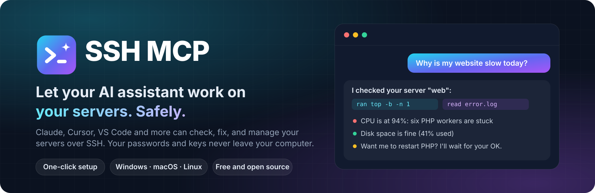
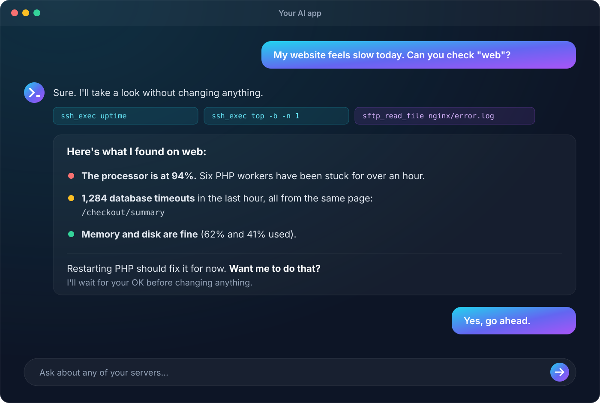
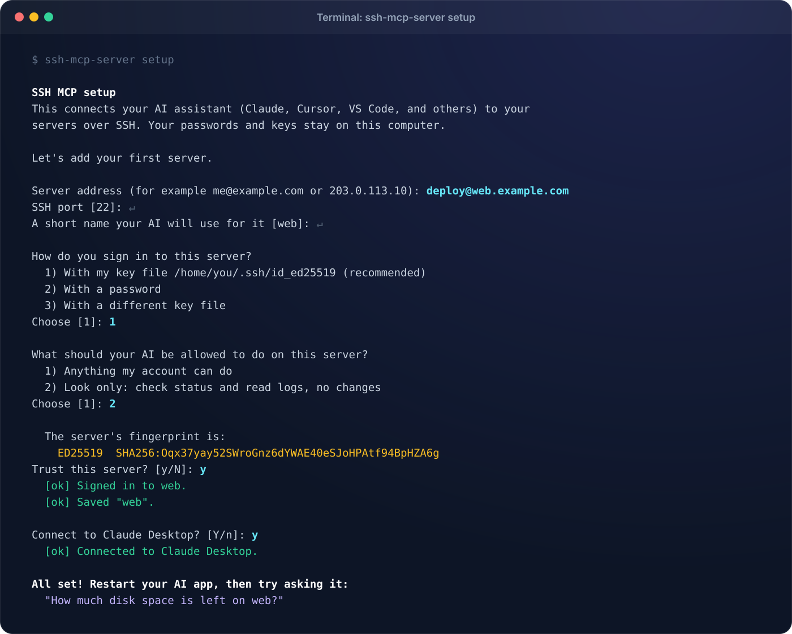
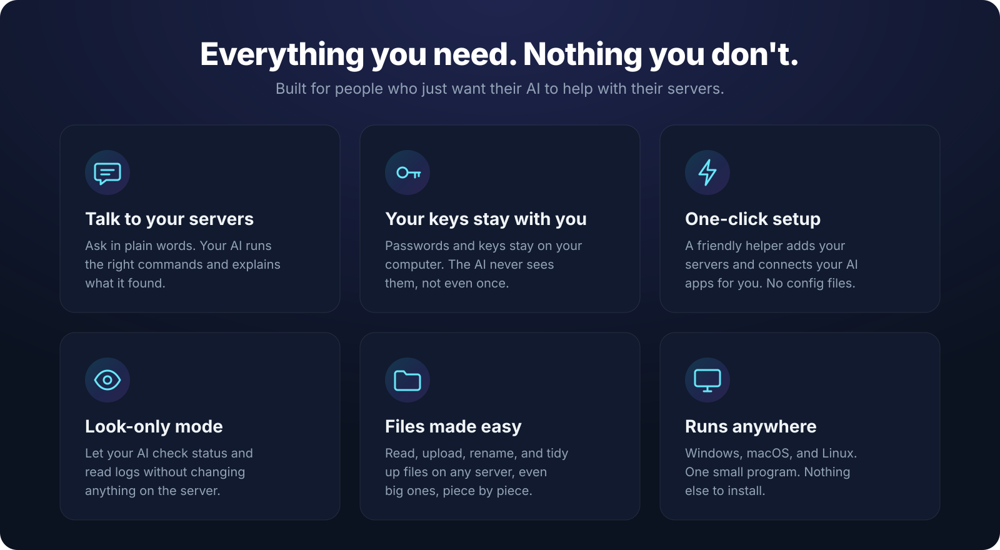
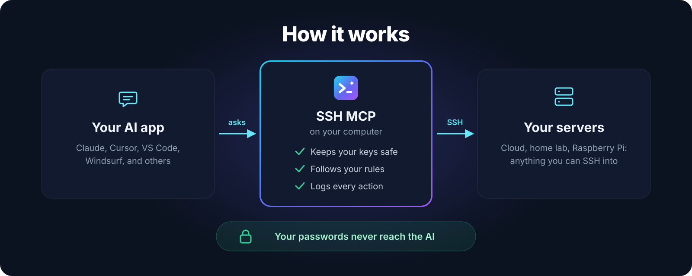

<p align="center">
  
</p>

<p align="center">
  <a href="https://github.com/anand34577/ssh-mcp/releases/latest"></a>
  <a href="https://github.com/anand34577/ssh-mcp/actions/workflows/ci.yml"></a>
  <a href="LICENSE"></a>
  
</p>

<p align="center">
  <b>Ask your AI about your servers in plain words. It signs in, checks, fixes, and explains.</b><br>
  Works with Claude, Codex, Cursor, VS Code, Gemini CLI, Windsurf, and any MCP app.<br>
  Your passwords and keys never leave your computer.
</p>

<p align="center">
  <a href="#install-in-one-step"><b>Install</b></a> ·
  <a href="https://github.com/anand34577/ssh-mcp/wiki"><b>Wiki</b></a> ·
  <a href="https://github.com/anand34577/ssh-mcp/wiki/What-You-Can-Ask"><b>What you can ask</b></a> ·
  <a href="https://github.com/anand34577/ssh-mcp/wiki/Staying-Safe"><b>Safety</b></a> ·
  <a href="https://github.com/anand34577/ssh-mcp/wiki/Troubleshooting"><b>Help</b></a>
</p>

---

## Talk to your servers

> **You:** My website feels slow today. Can you check "web"?
>
> **AI:** I checked web without changing anything. The processor is at 94% because six PHP workers are stuck, and the error log shows 1,284 database timeouts from `/checkout/summary`. Memory and disk are fine. Restarting PHP should fix it for now. **Want me to do that?**

<p align="center"></p>

No more copying commands between a chat window and a terminal. Your AI does the legwork, shows you what it found, and asks before it changes anything.

## Install in one step

**Windows** (PowerShell):

```powershell
irm https://raw.githubusercontent.com/anand34577/ssh-mcp/main/install.ps1 | iex
```

**macOS and Linux** (Terminal):

```bash
curl -fsSL https://raw.githubusercontent.com/anand34577/ssh-mcp/main/install.sh | sh
```

That's all. The installer picks the right version for your computer, checks the download is genuine, and starts a short setup. The setup:

1. adds your server,
2. confirms the server's identity,
3. tests the sign-in, and
4. connects your AI apps.

It needs no admin rights and installs nothing else.

<p align="center"></p>

Prefer to click? Download your file from the [latest release](https://github.com/anand34577/ssh-mcp/releases/latest) and open it. The setup starts by itself. Step-by-step guides: [Windows](https://github.com/anand34577/ssh-mcp/wiki/Install-on-Windows) · [macOS](https://github.com/anand34577/ssh-mcp/wiki/Install-on-macOS) · [Linux](https://github.com/anand34577/ssh-mcp/wiki/Install-on-Linux).

## Why you'll like it

<p align="center"></p>

- **Plain words in, real answers out.** Check health, read logs, find the cause, fix it, manage files.
- **Your secrets stay home.** Passwords and keys are used only on your computer and never reach the AI.
- **You set the limits.** Give full access, or *look-only* (status and logs, no changes) per server. Add your own allow and block lists.
- **Safe by default.** Every server's identity is verified. Commands have time and output limits. Every action is logged on your computer.
- **Works everywhere.** Windows, macOS, and Linux, on Intel/AMD and ARM. One small program with nothing else to install.
- **Private.** No analytics, no telemetry, no accounts. It only talks to your servers, and to GitHub when you ask it to update. [Read more](https://github.com/anand34577/ssh-mcp/wiki/Privacy).

<p align="center"></p>

## Works with your AI app

| App | Connected automatically |
|---|:---:|
| Claude Desktop | ✅ |
| Claude Code | ✅ |
| Codex (OpenAI) | ✅ |
| Gemini CLI | ✅ |
| Cursor | ✅ |
| VS Code (Copilot) | ✅ |
| Windsurf | ✅ |
| Zed, Cline, Continue, JetBrains, and any other MCP app | [Add by hand in a minute](https://github.com/anand34577/ssh-mcp/wiki/Connect-Your-AI-App) |

## Everyday commands

| I want to... | Run |
|---|---|
| Add, test, or remove servers | `ssh-mcp-server setup` |
| Connect a new AI app (or fix connections after moving the program) | `ssh-mcp-server connect` |
| Get the latest version | `ssh-mcp-server update` |
| Check that everything works | `ssh-mcp-server -validate -connect` |
| Remove it completely | `ssh-mcp-server uninstall` |

Updating keeps your servers and app connections. Moving to a new computer takes four steps: [see how](https://github.com/anand34577/ssh-mcp/wiki/Update-Move-or-Uninstall).

## Teach your AI good habits (optional)

[`skills/ssh-mcp`](skills/ssh-mcp/SKILL.md) is a ready-made skill that teaches the AI to:

- look before it acts,
- keep commands safe and non-interactive,
- read big files piece by piece,
- explain errors, and
- always ask before changing anything.

Copy the folder into `~/.claude/skills/` (Claude Code) or `~/.codex/skills/` (Codex), or upload it as a custom skill in Claude.

## Safety and privacy

SSH MCP can run commands on real servers, so it was built to keep you in control:

- **Secrets:** credentials never appear in anything the AI sees, and the settings file refuses to hold them.
- **Server identity:** fingerprints are verified on every connection.
- **Your rules:** they're enforced on your computer before anything reaches the server.
- **Downloads:** every one is checked against a published SHA-256 checksum.

The server account's own permissions are always the final limit, so a separate, limited account for the AI is the best protection of all.

More: [Staying Safe](https://github.com/anand34577/ssh-mcp/wiki/Staying-Safe) · [Privacy](https://github.com/anand34577/ssh-mcp/wiki/Privacy) · [Report a vulnerability](SECURITY.md)

---

## Technical reference

The sections below are for people who want the details. Everyday users can stop here.

<details>
<summary><b>How it fits together</b></summary>

SSH MCP is a [Model Context Protocol](https://modelcontextprotocol.io/) server. AI apps start it as a local program and talk to it over stdin/stdout. It connects to the servers listed in its settings file over SSH, enforces each server's rules, and returns results. Logs and audit lines go to stderr, never into the protocol stream.

There are two interchangeable editions with the same tools and settings file:

| Edition | Use it when | Runtime needed |
|---|---|---|
| **Go** (`go/`) | Almost always. This is what the installers and releases provide. | None. It's a single static program. |
| **Java 11** (`java/`) | Your organisation standardises on Java | None for the bundled-runtime archives; Java 11+ for the jar |

</details>

### Configuration reference

The settings file holds a `servers` array (plus an optional `$schema` for editor completion, see [`config/servers.schema.json`](config/servers.schema.json)). The setup writes it for you; this is the full list of fields.

| Field | Type | Default | Description |
|---|---|---|---|
| `id` | string | required | Unique name, `[A-Za-z0-9._-]{1,64}`. Tools address servers by this `serverId`. |
| `host` | string | required | Hostname or IP address. |
| `port` | integer | `22` | 1–65535. |
| `username` | string | required | Remote account. |
| `passwordEnv` | string | — | **Name** of the environment variable holding the password. Configure this, `privateKeyPath`, or both. |
| `privateKeyPath` | string | — | Private key file. Supports `~/`, `${user.home}`, and `${ENV_VAR}`. |
| `privateKeyPassphraseEnv` | string | — | Name of the variable holding the key's passphrase. |
| `knownHostsPath` | string | — | `known_hosts` file. Required while `strictHostKeyChecking` is `true`. |
| `strictHostKeyChecking` | boolean | `true` | `false` also needs `SSH_MCP_ALLOW_INSECURE_HOST_KEYS=true`. |
| `connectTimeoutMs` | integer | `10000` | 1000–120000. Connect, handshake, and sign-in timeout; also the wait for a free tunnel slot. |
| `commandTimeoutMs` | integer | `60000` | 100–3600000. Default and maximum command or file-operation time (connecting isn't counted). |
| `maxOutputBytes` | integer | `1048576` | 1024–104857600. Per output stream and per file read/write. |
| `maxConcurrentOperations` | integer | `4` | 1–64. Simultaneous commands and file operations. |
| `maxConcurrentTunnels` | integer | `4` | 1–64. Simultaneous tunnels, kept separate from operations. |
| `allowSftp` | boolean | `true` | Enables the file tools. |
| `allowPortForwarding` | boolean | `false` | Enables tunnels. |
| `allowedCommandPrefixes` | string[] | `[]` | When set, commands must start with one of these at a word boundary, and shell metacharacters are refused. |
| `deniedCommandRegexes` | string[] | `[]` | Any match refuses the command. Checked first. |

Load-time rules: unknown fields, out-of-range values (including an explicit `0`), inline secrets (`password`, `passphrase`, `privateKey`, `privateKeyContent`, `secret`), and duplicate ids are all rejected.

The settings file is looked up in this order:

1. `-config <path>`
2. `SSH_MCP_CONFIG`
3. `./config/servers.json`
4. `servers.json` or `config/servers.json` next to the program
5. the per-user file: `%APPDATA%\ssh-mcp\servers.json`, `~/Library/Application Support/ssh-mcp/servers.json`, or `~/.config/ssh-mcp/servers.json`

| Environment variable | Effect |
|---|---|
| `SSH_MCP_CONFIG` | Settings file path. |
| `SSH_MCP_ALLOW_INSECURE_HOST_KEYS` | `true` permits servers with `strictHostKeyChecking: false`. |
| `SSH_MCP_AUTO_ACCEPT_HOST_KEYS` | `true` disables host-key checks for every server. Emergency use only. |
| `SSH_MCP_VERSION` / `SSH_MCP_DOWNLOAD_URL` | Used by the installers and `update`: a specific release, or a mirror. |

### MCP tools

| Tool | Purpose | Requires |
|---|---|---|
| `ssh_list_servers` | Server ids and non-secret capabilities, limits, and allowed commands. | — |
| `ssh_exec` | Run a non-interactive command; returns stdout, stderr, exit code/signal, `timedOut`, truncation flags. | — |
| `sftp_list`, `sftp_stat` | Inspect remote paths. | `allowSftp` |
| `sftp_read_file` | Read UTF-8 or base64, paged with `offset` / `nextOffset`. | `allowSftp` |
| `sftp_write_file` | Create or replace a file. | `allowSftp` |
| `sftp_mkdir`, `sftp_rename`, `sftp_delete` | Create (`parents`), move (`overwrite`), delete (never recursive). | `allowSftp` |
| `ssh_tunnel_open`, `ssh_tunnel_list`, `ssh_tunnel_close` | Loopback-only local port forwards. | `allowPortForwarding` |

Every argument and result is documented in [`skills/ssh-mcp/references/tools.md`](skills/ssh-mcp/references/tools.md). Tools publish descriptions and MCP annotations (`readOnlyHint`, `destructiveHint`, …).

### Command line

```text
ssh-mcp-server setup [-config file]        guided setup (also opens on double-click)
ssh-mcp-server connect [-app a,b]          connect AI apps without questions
ssh-mcp-server update                      self-update, SHA-256 verified
ssh-mcp-server uninstall [-purge] [-yes]   remove from AI apps and delete the program
ssh-mcp-server -validate [-connect]        check every server (exit 0 when all are ready)
ssh-mcp-server [-config file]              run as an MCP server (what AI apps do)
ssh-mcp-server version | help
```

### Known limits

- Each tool call opens a fresh SSH connection. There's no persistent shell, so use absolute paths.
- No TTY or interactive programs. Commands that prompt block until their timeout.
- No SSH agent, GSSAPI/Kerberos, or one-time-code MFA. Very old servers that only speak deprecated algorithms won't connect.
- `deniedCommandRegexes` is a guard rail, not a sandbox. Use `allowedCommandPrefixes` and a least-privilege account for real restriction.
- `sftp_write_file` rewrites in place. For critical files, write a temporary file and `sftp_rename` it with `overwrite: true`.

### Build, test, and release

```bash
cd go && go test ./... && go build ./cmd/ssh-mcp-server      # Go 1.26+
cd java && mvn verify                                         # JDK 11+
```

- **CI:** tests on Linux and Windows, builds every platform, lints the installers, and tests Java 11 and 21.
- **Releases:** run on a `v*` tag, or from **Actions > Release > Run workflow**. Each one publishes every platform's program with checksums, Windows icon and version details, the installers, and the Java editions.
- **Wiki:** pages in [`wiki/`](wiki/) are published to the GitHub wiki automatically.

Details: [For Developers](https://github.com/anand34577/ssh-mcp/wiki/For-Developers) · [`go/README.md`](go/README.md) · [`java/README.md`](java/README.md) · [CONTRIBUTING.md](CONTRIBUTING.md)

## License

[MIT](LICENSE). Free for personal and commercial use.
